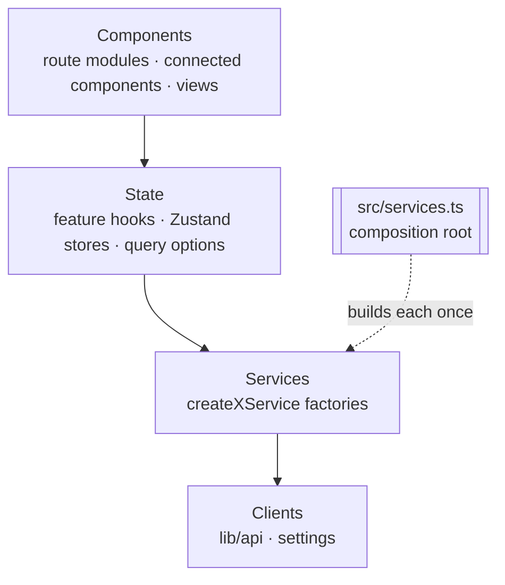
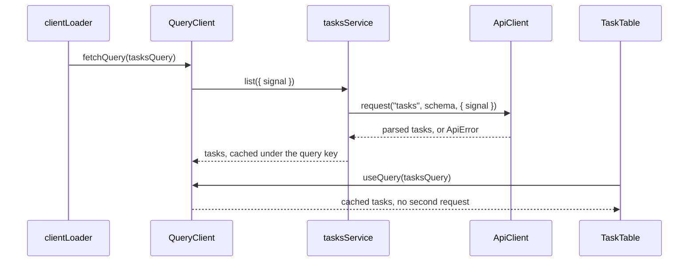

# Services and state

## Overview

Dependencies point one way: components, then the state layer (feature hooks, stores,
and query options), then services, then clients. Nothing imports a layer above it.



Views and connected components reach services only through the state layer: a
one-off action is a mutation in the feature hook, not a service call in JSX. Route
loaders and actions use query options or a service.

One request, from loader to screen:



## Services

A service is a stateless factory that receives its dependencies when it's created and
returns an object typed by an explicit interface. It holds I/O and domain decisions,
never UI or client state.

```ts
// tasks.service.ts
import type { ApiClient } from "~/lib/api/api";
import { type Task, taskSchema, tasksSchema } from "./tasks";

export interface TasksService {
	list(options?: { signal?: AbortSignal }): Promise<Task[]>;
	complete(id: string): Promise<Task>;
}

type Deps = { api: ApiClient };

export function createTasksService({ api }: Deps): TasksService {
	function taskPath(id: string) {
		return `tasks/${encodeURIComponent(id)}`;
	}

	async function list({ signal }: { signal?: AbortSignal } = {}) {
		return api.request("tasks", tasksSchema, { signal });
	}

	async function complete(id: string) {
		return api.request(`${taskPath(id)}/complete`, taskSchema, {
			method: "POST",
		});
	}

	return { list, complete };
}
```

- **Factories, not classes.** Without `this`, methods pass safely as callbacks
  (`mutationFn: tasksService.complete`).
- **An explicit interface for every service.** It's the contract, and the compiler
  flags drift. Name the file `<thing>.service.ts`, the interface `XService`, and the
  factory `createXService`. A stand-in for the same interface gets its own factory,
  such as `createDemoXService`.
- **One `Deps` object, destructured in the signature,** so every requirement shows at
  a glance.
- **`Deps` lists interfaces, never factories or imported instances:**
  `type Deps = { api: ApiClient; ledger: LedgerService }`.
- **Services import no React, router, TanStack, Zustand, UI, routes, or service
  instances.** Anything they need arrives through `Deps`. Biome enforces this.
- **Stateless, not pure.** I/O and side effects are fine; state kept between calls
  isn't.
- **Fixed file anatomy:** the interface, `Deps`, and the factory, nothing else.
- **Helpers live inside the factory,** above the public functions, and
  `return { ... }` at the bottom lists the public API.
- **Extract only standalone logic.** Schemas, types, and pure transformations that are
  shared or large go in the domain module beside the service (`tasks.ts`), never loose
  in the service file.
- **No default exports** and no static-only classes.

## Composition root

`src/services.ts` builds every service once and exports the instances. Services get
their dependencies at creation; everything else imports the instances.

```ts
// src/services.ts
import { createApiClient } from "~/lib/api/api";
import { env } from "~/lib/env/env";
import { createLedgerService } from "~/lib/ledger/ledger.service";
import { createBillingService } from "~/routes/billing/billing.service";

const api = createApiClient({ baseUrl: env.VITE_API_URL });

export const ledgerService = createLedgerService({ api });
export const billingService = createBillingService({ api, ledger: ledgerService });
```

- **One composition root.** Outside tests, it's the only module that imports a
  factory. Biome enforces this.
- **Factories stay with their domain,** beside a route or in a `src/lib` capability;
  only the instances live here.
- **Build in dependency order.** A service that depends on another is created after
  it and receives the instance through `Deps`.
- **Never call a factory in a component or hook.** It would create a new instance on
  every render.
- **Consumers import instances:** `import { tasksService } from "~/services"`. Query
  options, hooks, and stores never construct services.
- **Swap implementations here.** A fake server, fixture data, or a demo mode changes
  this file, not its consumers.

## State ownership

Every kind of state has one owner, and data never lives in two.

| Kind of state | Owner | Examples |
| --- | --- | --- |
| Remote data (fetched, cached, invalidated) | TanStack Query, calling services | Tasks, a project's details, reference data |
| State that survives reload, Back, and shared links | React Router (the URL) | Filters, sort, page, a wizard's step, the open record |
| Form values, validation, and submission | TanStack Form | A request form's fields and errors |
| Table behavior | TanStack Table | Row selection, column visibility |
| Timing | TanStack Pacer | A debounced search, a throttled autosave |
| Shared client state no library owns | Zustand stores | The theme, a draft that spans routes |
| One component's state | `useState` / `useReducer` | An open popover, hover, focus |

- **Query functions call services:** `queryFn: ({ signal }) => tasksService.list({
  signal })`. Services know nothing about Query.
- **Each domain's query options and keys live in its `<thing>.query.ts`.** Loaders
  and components share the options. Add a key factory once there's more than one
  query or a mutation invalidates them.
- **Mutations call services and invalidate keys.** Stores aren't updated with server
  results.
- **Never copy query data into a store,** loader data, or an effect. Derive from it in
  hooks or components.
- **Promote to Zustand only when state is shared** and no library above owns it.
  State one component uses stays local.

```ts
// tasks.query.ts
import { queryOptions } from "@tanstack/react-query";
import { tasksService } from "~/services";

export const taskKeys = {
	all: ["tasks"] as const,
	list: () => [...taskKeys.all, "list"] as const,
};

export const tasksQuery = queryOptions({
	queryKey: taskKeys.list(),
	queryFn: ({ signal }) => tasksService.list({ signal }),
});
```

```ts
// useTaskActions.ts: the feature hook owns the mutation
export function useTaskActions() {
	const queryClient = useQueryClient();
	const complete = useMutation({
		mutationFn: tasksService.complete,
		onSuccess: () => queryClient.invalidateQueries({ queryKey: taskKeys.all }),
	});
	return { completeTask: complete.mutate, isCompleting: complete.isPending };
}
```

## Stores

Stores are global, module-level Zustand stores that hold shared client state and
expose thin actions. Decisions stay in services.

```ts
// lib/request-draft/request-draft.ts
import { create } from "zustand";

type RequestDraftState = {
	draft: RequestDraft;
	updateDraft(patch: Partial<RequestDraft>): void;
	reset(): void;
};

export const initialState = { draft: emptyRequestDraft };

export const useRequestDraftStore = create<RequestDraftState>()((set) => ({
	...initialState,
	updateDraft: (patch) => set((state) => ({ draft: { ...state.draft, ...patch } })),
	reset: () => set(initialState),
}));
```

- **Global by default.** One store per concern, created at module level in the
  capability that owns it (`lib/theme`).
- **A store that holds user data exports `initialState` and a `reset` action.** Tests
  and identity changes reset it to a known state.
- **Actions are thin.** They set state or call a service. Branching and domain
  decisions belong in services, and remote results belong in Query.
- **Components subscribe with selectors** (`useThemeStore((state) => state.theme)`),
  never the whole store.
- **Stores import service instances** from `~/services` when an action needs one.
  Services never import stores.
- **Don't move a local workflow into a store** just to empty a component.

## Cross-store coordination

Stores may read each other at action time; they never write to or subscribe to each
other. Coordination that spans stores lives in a hook.

| Situation | Approach | Allowed |
| --- | --- | --- |
| A component needs data from two stores | A hook reads both with selectors | Yes |
| An action needs another store's current value once | `useOtherStore.getState().value` inside the action | Yes |
| One user action updates several stores | A coordinating hook calls each store's action | Yes |
| An action in store A calls store B's setter | — | No: hidden coupling, import cycles |
| Store A subscribes to store B | — | No: the hardest coupling to trace |

```ts
// useStartRequest.ts
export function useStartRequest() {
	const reset = useRequestDraftStore((state) => state.reset);
	const selectWorkspace = useWorkspaceStore((state) => state.select);

	return (workspaceId: string) => {
		selectWorkspace(workspaceId);
		reset();
	};
}
```

- **`getState()` reads are one-time and non-reactive.** Use them inside actions and
  event handlers, never while rendering; use a selector there.
- **Name coordinating hooks after the user's intent** (`useStartRequest`), not the
  stores they touch.

## Testing

Test each layer through its public surface, with fakes wherever the architecture
allows them.

| Layer | How to test | What to fake |
| --- | --- | --- |
| Services | Call the factory with fake `Deps`; assert on the returned interface | `ApiClient`, settings, and other services, typed as their interfaces |
| Query options | Through the route with `renderRoute` and a cleared `QueryClient` | `fetch`, or the service instance with `vi.spyOn` |
| Stores | Call actions and assert on `getState()`; `reset()` in `beforeEach` | Service instances with `vi.spyOn` |
| Feature and coordinating hooks | Through the component that uses them, or `renderHook` | Services with `vi.spyOn`; reset stores |
| Routes and components | Behavior through the UI with `renderRoute` | `fetch`, or services with `vi.spyOn` |

- **Test service helpers through the service's interface,** not by exporting them.
- **Type fakes as the interface** (`const api: ApiClient = { ... }`), so contract drift
  fails to compile.

```ts
// tasks.service.test.ts
it("lists tasks, passing the caller's signal to the client", async () => {
	const api: ApiClient = { request: vi.fn().mockResolvedValue(tasks) };
	const signal = new AbortController().signal;

	await expect(createTasksService({ api }).list({ signal })).resolves.toEqual(tasks);
	expect(api.request).toHaveBeenCalledWith("tasks", expect.anything(), { signal });
});
```

## Exceptions

Deviate only in these cases, with a short comment at the definition saying why.

| Exception | When it's justified | Default it replaces |
| --- | --- | --- |
| Class instead of factory | Something requires a class: `instanceof` (`ApiError`), a `dispose()` lifecycle, many instances on a hot path | Factory function |
| Context-scoped store | Several independent instances at once, such as one per open editor | Global module-level store |
| Service created outside the composition root | Test files only | `src/services.ts` |
| Browser effect in a store action | It only presents or persists the store's own state, as `lib/theme` sets the document class and localStorage | I/O in a service |

Anything else follows the defaults. Add a recurring exception to this table instead of
deciding it case by case.

## Review

Check, in order: dependency direction, remote data in stores, decisions in store
actions, store-to-store writes or subscriptions, factories used outside the
composition root, and missing interfaces or `Deps` that aren't interfaces. Report
each violation with its rule and a concrete fix.

## Examples

- Services on a fixture client: `src/routes/examples/query/projects.service.ts` (with
  its test), `table/tasks.service.ts`, and `pacer/task-search.service.ts`.
- Stand-in implementations: `form/project-request.service.ts` and
  `pacer/note.service.ts`.
- Query options: `query/projects.query.ts`, `table/tasks.query.ts`.
- A mutation calling a service:
  `form/components/ProjectRequestForm/useProjectRequestForm.ts`.
- Tests that swap a fake server with `vi.spyOn`: `form/form.route.test.tsx` and
  `pacer/pacer.route.test.tsx`.
