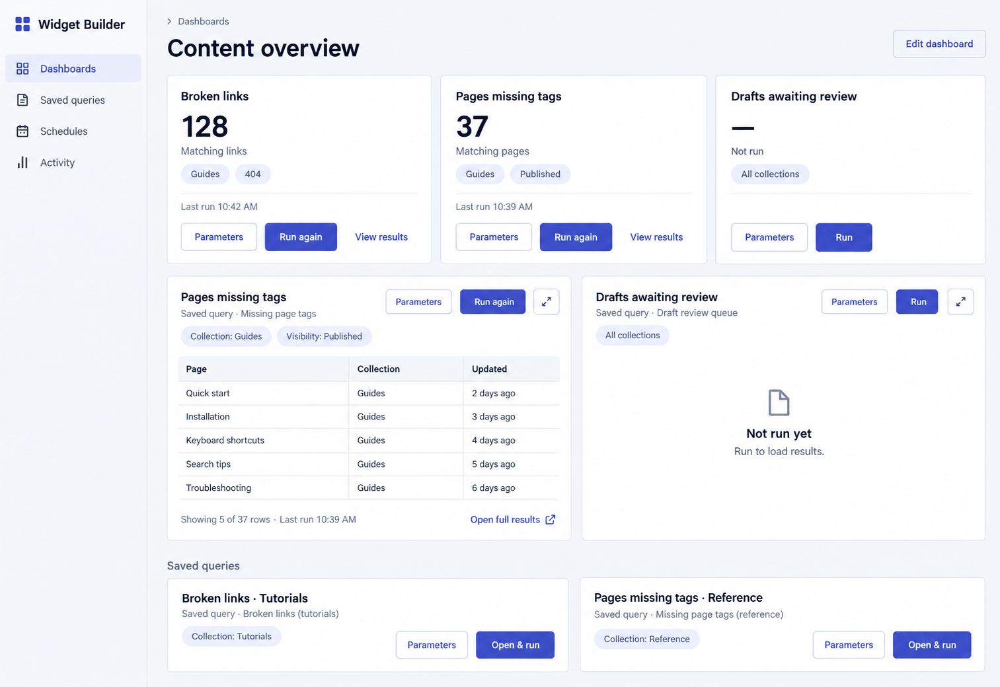
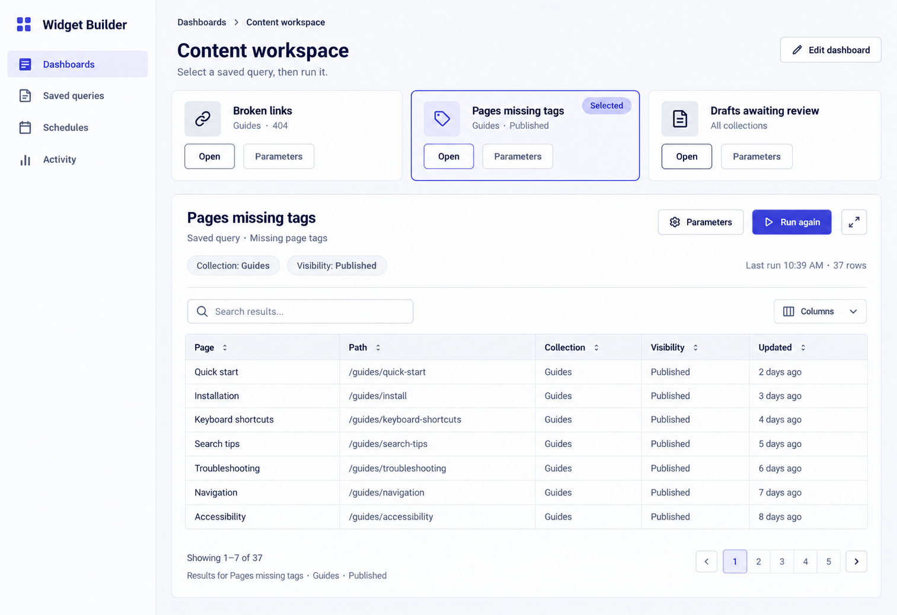
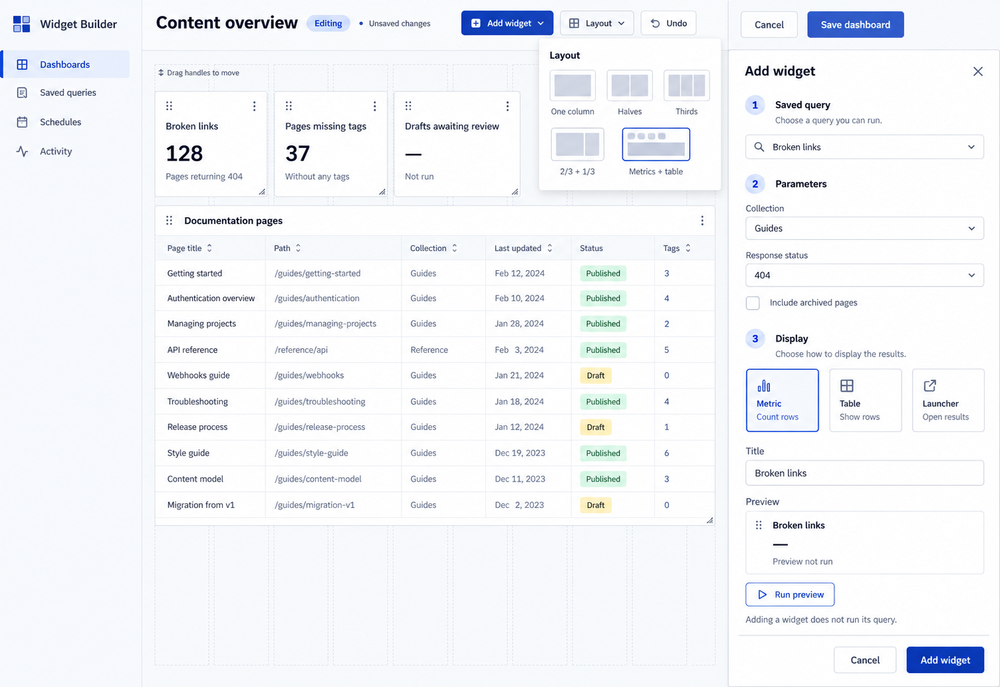

# Dashboard & Widget Builder

A design and implementation reference for configurable dashboards backed by saved queries.

The pattern combines a constrained widget catalogue, schema-driven parameter forms, explicit execution controls, and a responsive editing canvas. It supports both a dashboard that keeps several results visible and a workbench for investigating one result at a time.

The example workspace manages documentation: broken links, pages missing tags, and drafts awaiting review.

## Visual concepts

### Dashboard

### Workbench

### Builder

## Start here

| File | Contents |
| --- | --- |
| [Design specification](docs/design-spec.md) | Navigation, widget behavior, parameters, execution states, layout editing, permissions, and scope |
| [Implementation guide](docs/implementation-guide.md) | React composition, state ownership, asynchronous execution, layout persistence, and extension points |
| [Type contracts](reference/contracts.ts) | Framework-independent definitions for sources, widgets, dashboards, executions, and adapters |
| [Acceptance scenarios](docs/acceptance-scenarios.md) | Observable behavior for reviewing an implementation |
| [Image prompts](docs/image-prompts.md) | Reusable briefs for dashboard, workbench, builder, and interaction-detail mockups |
| [Sample data](examples/sample-data.json) | Source definitions, parameters, example widgets, and documentation rows |

## Core decisions

1. Each widget references one saved query and its configured parameters.
2. Metric and Table are the core widget types. Launcher is an optional compact shortcut.
3. Opening a dashboard never executes its queries.
4. Not run, zero results, running, and failure are different states.
5. Results retain the exact source revision and parameters that produced them.
6. Dashboard editing uses a draft with Save and Cancel.
7. Layout changes and source execution are separate operations.
8. Large tables expand into a dedicated results surface.
9. Editing a dashboard does not grant permission to author or execute its sources.

## Widget catalogue

| Widget | Presentation | Main use |
| --- | --- | --- |
| Metric | Row count, parameter summary, timestamp, and result link | Check how many items match a saved query |
| Table | Fixed-size result preview with an expanded view | Inspect and compare several datasets |
| Launcher | Compact source/parameter preset with an explicit action | Keep many recurring queries within reach |

A table before its first execution is still a Table widget. Its body shows Not run and a Run action.

## Two runtime layouts

**Dashboard:** metrics and tables retain their own results. Users can compare several checks without replacing the previous dataset.

**Workbench:** saved-query selectors sit above one large results workspace. Open selects a query; Run executes it. The workspace always repeats the selected source and parameter values.

Use the dashboard as the default. Choose the workbench when wide tables and sequential investigation dominate.

## Builder workflow

Choose a saved query → configure its parameters → choose a display → adjust presentation → add the widget.

The builder offers a 12-column desktop grid, sensible initial sizes, header drag handles, resize handles, and explicit layout presets. A right-side drawer handles widget configuration. A separate Run preview action executes the draft query.

## Example

A Pages missing tags widget uses:

- Saved query: Missing page tags.
- Collection: Guides.
- Visibility: Published.
- Display: Table.
- Preview: five rows from an execution with 37 matching pages.

Parameters opens a form for that widget. Run again executes its selected inputs. Open full results reuses the available execution. Changing the display or layout does not run the query.

## Implementation approach

Keep four concerns separate: source definitions, persistent dashboard configuration, edit drafts, and runtime execution records. A renderer registry maps widget kinds to components. A source adapter exposes parameter definitions, execution, and result retrieval. The grid layer controls placement.

[React Grid Layout](https://github.com/react-grid-layout/react-grid-layout) is one available layout engine with dragging, resizing, and responsive breakpoints. Keep library-specific props behind a canvas adapter so product behavior remains expressed in the application model.

## Suggested first release

Metric and Table widgets; explicit manual execution; generated parameter forms; inline and expanded results; dashboard draft editing; constrained layout presets; accessible movement controls; and server-enforced source permissions.

The specification also defines optional launchers, workbench behavior, schedule-linked results, and future extensions.

